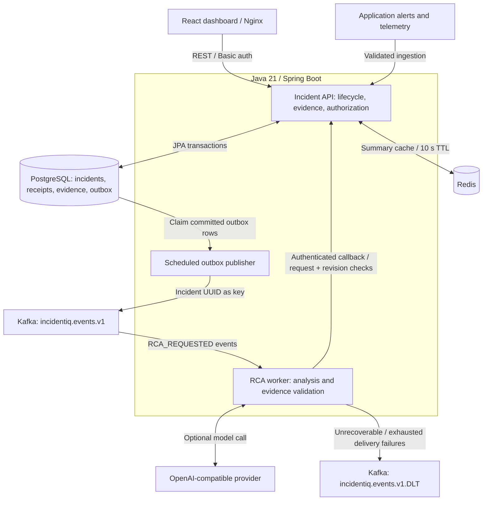
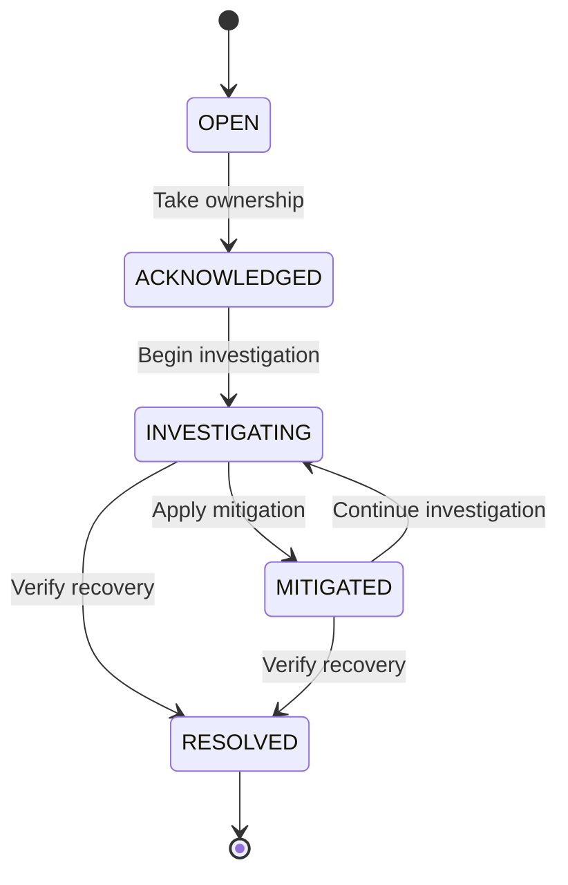
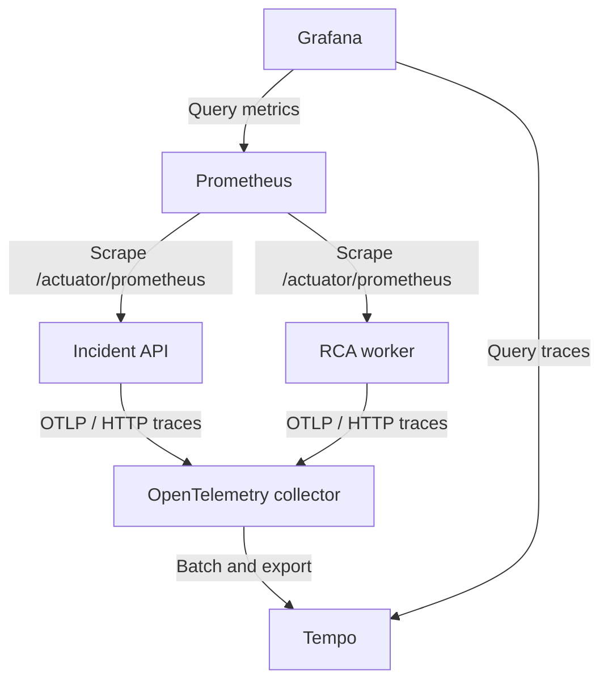

# IncidentIQ Architecture

IncidentIQ is a Java Full Stack reference application for turning alerts into owned incidents and evidence-based root cause investigations. The design separates **transactional incident management** from **asynchronous analysis**, while keeping one API responsible for incident state.

**Stack:** Java 21, Spring Boot 3.5, React 19, PostgreSQL, Kafka, Redis, Micrometer/OpenTelemetry, Docker and Kubernetes. Terraform and GitHub Actions provide an optional Azure AKS deployment path.

[Run the demo](README.md#start-with-the-lightweight-demo) · [Review the implementation](#code-and-test-guide) · [Event guarantees](docs/ARCHITECTURE.md) · [API contract](docs/API.md) · [Validation record](docs/VALIDATION.md)

## System diagram

The diagram shows the event-driven `cloud` profile. Both local run modes are compared below.



**Ownership:** the API alone writes incident data. The publisher runs inside the API application. The worker consumes immutable evidence snapshots and sends results back through the API; it does not directly query PostgreSQL. Redis holds derived dashboard summaries. PostgreSQL is the system of record.

Lifecycle events also use the Kafka topic; the RCA consumer ignores events other than `RCA_REQUESTED`. A missing key, provider failure or invalid model output produces an explicitly labeled **HEURISTIC** result.

## Component responsibilities

| Component | Responsibility | Implementation |
| --- | --- | --- |
| React dashboard | Incident filters, response drawer, notes, service health, evidence and analysis views | [frontend/src/main.jsx](frontend/src/main.jsx) |
| Incident API | Validate requests, enforce roles and state transitions, group alerts, persist evidence and accept RCA callbacks | [IncidentController.java](incident-service/src/main/java/dev/incidentiq/api/IncidentController.java), [IncidentService.java](incident-service/src/main/java/dev/incidentiq/api/IncidentService.java) |
| PostgreSQL / Flyway | Durable state, receipt keys, audit entries and transactional outbox | [V1__initial_schema.sql](incident-service/src/main/resources/db/migration/V1__initial_schema.sql) |
| Outbox publisher | Claim committed rows, wait for Kafka acknowledgement and record publication | [OutboxPublisher.java](incident-service/src/main/java/dev/incidentiq/api/OutboxPublisher.java), [Repositories.java](incident-service/src/main/java/dev/incidentiq/api/Repositories.java) |
| RCA worker | Consume requests, validate model output, fall back to the baseline and call the internal API | [RcaConsumer.java](rca-worker/src/main/java/dev/incidentiq/worker/RcaConsumer.java), [AiAnalyzer.java](rca-worker/src/main/java/dev/incidentiq/worker/AiAnalyzer.java) |
| Shared contracts | Versioned event/context records, evidence IDs, redaction and heuristic analysis | [contracts](contracts/src/main/java/dev/incidentiq/contracts) |
| Redis | Cache the dashboard summary for ten seconds; ingestion and lifecycle transitions evict it | [CacheConfig.java](incident-service/src/main/java/dev/incidentiq/api/CacheConfig.java) |

## Alert ingestion and consistency

1. The API authenticates the caller, validates the payload and locks the registered service row. This serializes grouping and receipt checks for that service.
2. A SHA-256 key derived from `source:eventId` identifies the receipt. The same key and payload return the original incident without incrementing occurrences; changed content with the same key returns **409 Conflict**.
3. The API groups a new event into an active incident matching its service and source-derived fingerprint. A matching alert after resolution creates a new incident.
4. In one database transaction, it saves the incident, redacted logs, timeline entry, alert receipt and outbox event. New evidence advances the evidence revision and invalidates old RCA.
5. The scheduled publisher claims up to 20 unpublished rows using `FOR UPDATE SKIP LOCKED`, sends them to Kafka and marks them published after broker acknowledgement.

This avoids a direct database-plus-broker dual write in the request handler. A crash after Kafka accepts a message but before the database commits its publication marker can still produce duplicates. The delivery contract is **at least once**. Incident keys select Kafka partitions; multiple outbox publishers do not guarantee global or per-incident publication order.

## Asynchronous RCA flow

```mermaid
sequenceDiagram
    actor User as Responder
    participant API as Incident API
    participant DB as PostgreSQL
    participant Kafka as Kafka
    participant Worker as RCA worker

    User->>API: POST /api/incidents/{id}/rca
    API->>DB: Lock incident; save request ID and outbox snapshot
    DB-->>API: Transaction committed
    API-->>User: Incident with RCA status QUEUED
    Note over API: Scheduled outbox publisher runs inside the API
    API->>DB: Claim committed outbox rows
    API->>Kafka: Publish RCA_REQUESTED
    Kafka-->>API: Broker acknowledgement
    API->>DB: Mark event published
    Kafka->>Worker: Deliver evidence snapshot
    Note over Worker: Optional AI call, output validation or heuristic fallback
    Worker->>API: Callback with request ID, revision and analysis
    API->>DB: Lock incident and check request / evidence revision
    alt Current request is queued
        API->>DB: Save analysis and completion timeline entry
        API-->>Worker: 200 COMPLETED
    else Same request already completed
        API-->>Worker: 200 existing result; no repeated effects
    else Request or evidence is obsolete
        API-->>Worker: 409; discard stale result
    end
    User->>API: Refresh incident details
    API-->>User: Current evidence and analysis status
```

The model never holds an ingestion transaction open. Analysis runs against the latest **30 log entries captured at request time**, each with an immutable evidence ID. If new alert/log evidence arrives during analysis, the callback cannot overwrite the newer revision.

## Incident lifecycle



The server enforces transitions and records the actor, note and timestamp. Invalid transitions return 409. Acknowledgement and resolution timestamps drive MTTA and MTTR. A resolved incident stays resolved; a later matching alert opens a new incident.

## Failure handling and guarantees

| Scenario | Implemented behavior | Boundary |
| --- | --- | --- |
| Exact alert replay | Return the existing incident without repeating ingestion effects | Receipt retention determines how long replay protection can be preserved |
| Broker unavailable | Committed outbox rows remain pending and later publication runs retry | Backlog needs monitoring and a retention policy |
| Duplicate event delivery | A repeated completed callback returns the existing result | Model inference may run more than once and incur repeated cost |
| New evidence during analysis | Revision/request mismatch returns 409; the worker discards the result | A responder must request analysis for the new evidence |
| Provider missing, unavailable or returning invalid evidence IDs | Complete with a labeled heuristic baseline | A hypothesis is advisory and requires human verification |
| Retryable consumer/callback failure | Three retries after the initial attempt, then dead-letter publication | Invalid arguments are classified as non-retryable; DLT replay is an operator task |
| Analysis remains queued for five minutes | Maintenance marks it FAILED so a responder can retry | There is no automatic end-to-end RCA recovery workflow |

A failed dead-letter publication is not silently acknowledged. See [event guarantees and exact rules](docs/ARCHITECTURE.md#event-guarantees) for topic configuration, severity thresholds and callback behavior.

## Data model and security boundaries

All durable business data belongs to the API.

| Table | Purpose |
| --- | --- |
| `service_catalog` | Registered services, default on-call team and latest telemetry |
| `incidents` | Lifecycle, assignment, occurrence count, optimistic version, evidence revision and current analysis |
| `incident_logs` | Redacted evidence with stable UUIDs, timestamps and optional trace references |
| `incident_timeline` | Response history with actor, event type and note |
| `alert_receipts` | Durable idempotency key, payload hash and resulting incident |
| `outbox_events` | Event payload, publication timestamp and delivery-attempt count |

[Spring Security](incident-service/src/main/java/dev/incidentiq/api/SecurityConfig.java) separates viewer reads, responder mutations, admin service registration and worker-only internal callbacks. The reference setup uses environment-configured Basic-auth accounts, not a multi-user identity service.

Redaction happens before evidence storage. The worker treats incident text and logs as untrusted input, checks output structure and evidence references, and never executes remediation. Regex redaction and evidence-ID validation do not establish that a model's diagnosis is correct. HTTPS, managed secrets, OIDC/SSO and further data controls are deployment work before using real operational data.

## Observability



The optional Compose observability profile provisions a Grafana operations dashboard. Metrics include alert outcomes, pending outbox rows, completed RCA, provider success/fallback and resolution durations, alongside HTTP/JVM metrics.

Kafka trace-header propagation is not guaranteed by the custom outbox payload; incident, event and request IDs are the correlation keys at that boundary. Evidence logs arrive through the API; the repository does not include a general-purpose centralized log store.

## Design decisions and trade-offs

| Decision | Why it fits this project | Cost / next step |
| --- | --- | --- |
| Separate API and RCA worker | Slow inference runs outside interactive incident-management requests; worker capacity can be tuned separately | Adds a broker, callback authentication and eventual consistency |
| Transactional outbox | Incident changes and their event intent commit together | Polling adds delay, database work and a duplicate-delivery window |
| One service owns incident state | Lifecycle, audit and revision checks have one enforcement point | Worker completion depends on API availability |
| Service-row locking for ingestion | Makes same-service grouping and idempotency decisions deterministic under concurrency | Serializes ingestion for a busy service; benchmark before changing lock granularity |
| Redis for derived summaries | Shares short-lived cached summaries across API replicas | Cache errors are not a documented graceful-degradation path; summary queries still scan retained incidents |
| Evidence-bound AI with a deterministic fallback | Reviewable hypotheses and an offline demo without an AI subscription | Bounded context can miss relevant evidence; repeated requests can repeat provider cost |
| Lightweight and event-driven profiles | Reviewers can try the full UI before running the infrastructure | H2/synchronous demo behavior does not validate PostgreSQL/Kafka integration |

## Runtime and deployment modes

| Mode | State and processing | Purpose |
| --- | --- | --- |
| `demo` / `compose.demo.yml` | In-memory H2, in-process cache, synchronous heuristic analysis | Fast local review; four synthetic incidents; resets on restart |
| `cloud` / `compose.yml` | PostgreSQL, Redis, Kafka and separate RCA worker; AI is optional | Exercise asynchronous delivery and durable state locally |
| Kubernetes / AKS configuration | Application manifests, probes, resource limits, API HPA/PDB, Terraform and a manual deployment workflow | Deployment path supplied; live Azure provisioning is not claimed |

See [deployment instructions](docs/DEPLOYMENT.md) and the [runbook](docs/RUNBOOK.md). Sample stateful services are single-node; application replica settings alone do not provide end-to-end high availability.

## Code and test guide

| Engineering question | Read the implementation | Check the behavior |
| --- | --- | --- |
| How do replay protection and grouping work? | [IncidentService.java](incident-service/src/main/java/dev/incidentiq/api/IncidentService.java) | [CoreWorkflowTest.java](incident-service/src/test/java/dev/incidentiq/api/CoreWorkflowTest.java): `alertReplayIsIdempotentAndRelatedAlertsAreGrouped`, `reusedEventWithDifferentPayloadIsRejected` |
| How are events published after a commit? | [OutboxPublisher.java](incident-service/src/main/java/dev/incidentiq/api/OutboxPublisher.java), [Repositories.java](incident-service/src/main/java/dev/incidentiq/api/Repositories.java) | [Real-stack smoke test](scripts/smoke.py), invoked by [CI](.github/workflows/ci.yml); crash-window fault injection remains future work |
| Can a stale analysis replace newer evidence? | [IncidentService.java](incident-service/src/main/java/dev/incidentiq/api/IncidentService.java): `completeRca` | [CoreWorkflowTest.java](incident-service/src/test/java/dev/incidentiq/api/CoreWorkflowTest.java): `callbackIsIdempotentAndRejectsStaleAnalysis` |
| How are AI evidence references checked? | [AiAnalyzer.java](rca-worker/src/main/java/dev/incidentiq/worker/AiAnalyzer.java) | [AiAnalyzerTest.java](rca-worker/src/test/java/dev/incidentiq/worker/AiAnalyzerTest.java): `inventedEvidenceFallsBackToLabeledBaseline` |
| Are roles enforced by the API? | [SecurityConfig.java](incident-service/src/main/java/dev/incidentiq/api/SecurityConfig.java) | [SecurityApiTest.java](incident-service/src/test/java/dev/incidentiq/api/SecurityApiTest.java) |
| Does the operator workflow work in a browser? | [React dashboard](frontend/src/main.jsx) | [Playwright scenarios](frontend/e2e/incident.spec.js): operator lifecycle and viewer controls |

The [validation record](docs/VALIDATION.md) identifies a completed verification run and its limits. [Current main-branch checks](https://github.com/shashank4066/IncidentIQ/actions/workflows/ci.yml?query=branch%3Amain) are the source for current build status. No throughput, latency, uptime or production usage numbers are claimed without measurements.

## Next engineering milestones

1. **Measure throughput and recovery:** add a reproducible load profile and fault-injection cases for broker loss, duplicate publication and callback interruption; publish measured results with hardware/configuration.
2. **Reduce database work:** replace full incident scans with indexed SQL aggregates or materialized views, and define retention for receipts, logs and published outbox rows.
3. **Strengthen identity and operations:** OIDC/SSO, managed secrets, rate limits, managed stateful services, backup/restore drills and a documented DLT replay procedure.
4. **Control inference cost and tracing:** deduplicate analysis by request ID and evidence revision, and explicitly propagate trace context across the outbox/Kafka boundary.

These are planned improvements, separate from the behavior demonstrated by the current implementation.
