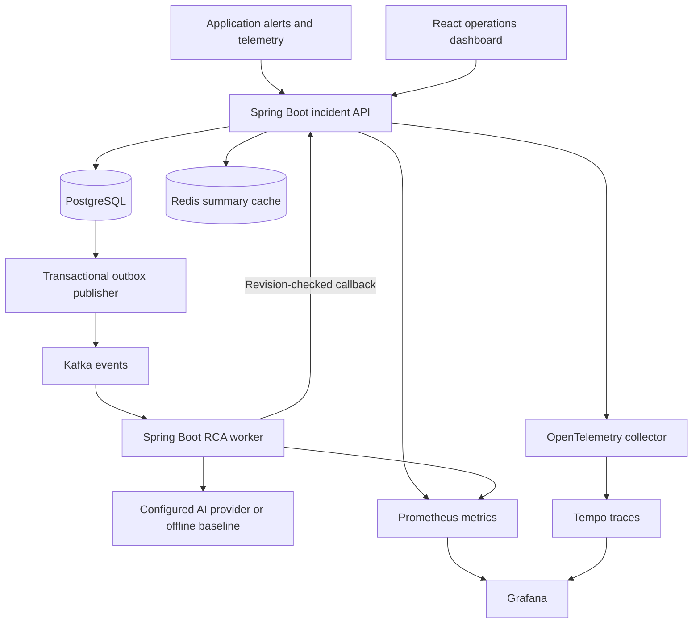

# Architecture

The API owns incident data. The worker owns analysis execution and persists results through an authenticated API callback; it has no direct database credentials requirement. Redis is a ten-second summary cache. PostgreSQL remains the system of record.

## Alert processing

The API validates a bounded payload, locks its registered service row, and checks a SHA-256 receipt key derived from source and event ID. A matching payload returns the existing incident without repeating effects. A differing payload with the same key conflicts. A matching active fingerprint groups the alert; a resolved fingerprint starts a new incident. The transaction saves logs, audit entries, receipt and outbox together. Optimistic versions protect incident changes that race with ingestion.

Default severity: SEV1 at error rate ≥0.20; SEV2 at ≥0.05 or p95 ≥3000 ms; SEV3 at ≥0.01 or p95 ≥1000 ms; otherwise SEV4. Explicit severity overrides classification. Related alerts may escalate severity, never silently downgrade it. Error rate is a ratio, not a percentage.

## Event guarantees

`incidentiq.events.v1` has three partitions with incident UUID keys. The outbox claims rows using PostgreSQL `FOR UPDATE SKIP LOCKED`, waits for broker acknowledgement and marks publication in the same database transaction. A crash after Kafka acceptance but before the database commit can duplicate an event. Delivery is **at least once**, not exactly once. Ordering is not guaranteed across multiple outbox publishers, so the consumer relies on immutable evidence revision and request IDs rather than arrival order.

Events include schema version, event UUID, type, incident ID, request ID when relevant, timestamp and a context snapshot. Lifecycle events and `RCA_REQUESTED` share the topic. The RCA group ignores lifecycle events. Failed processing retries three times after the first attempt and publishes to `incidentiq.events.v1.DLT`; DLT publish failures are retried instead of silently acknowledged. A request left queued for five minutes becomes failed and may be explicitly retried.

Callbacks are checked under an incident lock. Repeating a completed callback is harmless. A callback from an old request or evidence revision returns 409 and is discarded by the worker. New alerts/log evidence invalidate the current analysis. Repeated delivery can still incur repeated model inference; provider cost deduplication is a future improvement.

## Evidence and AI

A request captures the latest 30 stored log entries. Every entry has an immutable UUID, timestamp, level and optional trace ID. Common passwords, bearer tokens, key/value secrets and emails are redacted before storage. Unknown credential formats may remain; do not treat the regex redactor as a compliance boundary.

The model is told that incident fields/logs are untrusted data. Output JSON is bounded, evidence references are checked against the snapshot, and a human reviews all recommendations. If the provider is absent or fails, the deterministic baseline returns a clearly labeled result. There is no autonomous infrastructure mutation.

## Health and metrics

A heartbeat older than ten minutes is UNKNOWN. A fresh down heartbeat or active SEV1 yields DOWN. Active SEV2 or telemetry error rate ≥2% yields DEGRADED; otherwise it is HEALTHY. Resolving an incident does not modify telemetry.

MTTA is mean(created → acknowledged) for acknowledged incidents; MTTR is mean(created → resolved) for resolved incidents. Missing samples are null, displayed as an em dash. The dashboard's means cover all retained incidents; the volume chart covers the last seven UTC dates. Example data is synthetic and is enabled only by explicit seeding configuration.

Custom Prometheus metrics: `incidentiq_alerts_total{result}`, `incidentiq_outbox_pending`, `incidentiq_rca_completed_total`, `incidentiq_ai_requests_total{result}`, and `incidentiq_resolution_duration_seconds_*`. HTTP request histograms and JVM metrics come from Actuator/Micrometer. OTLP traces use the Micrometer/OpenTelemetry bridge. Kafka trace-header propagation is not guaranteed by the custom outbox payload; use incident/event IDs to correlate that asynchronous boundary.
